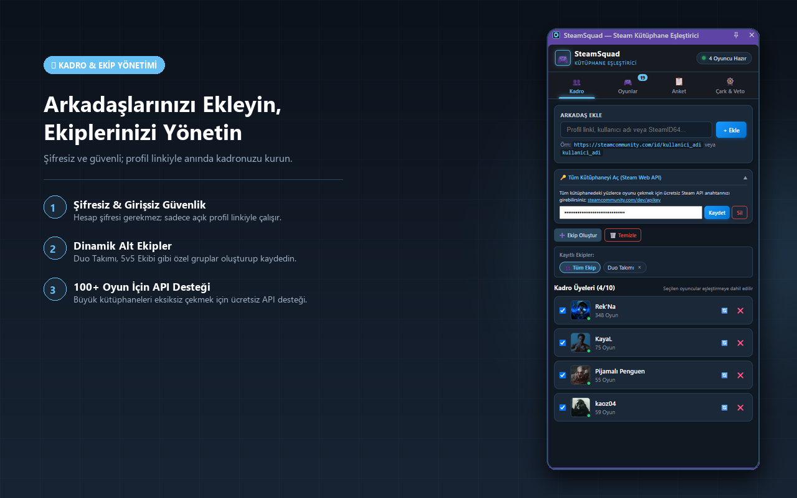
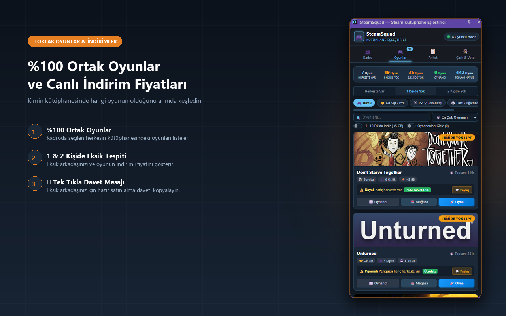
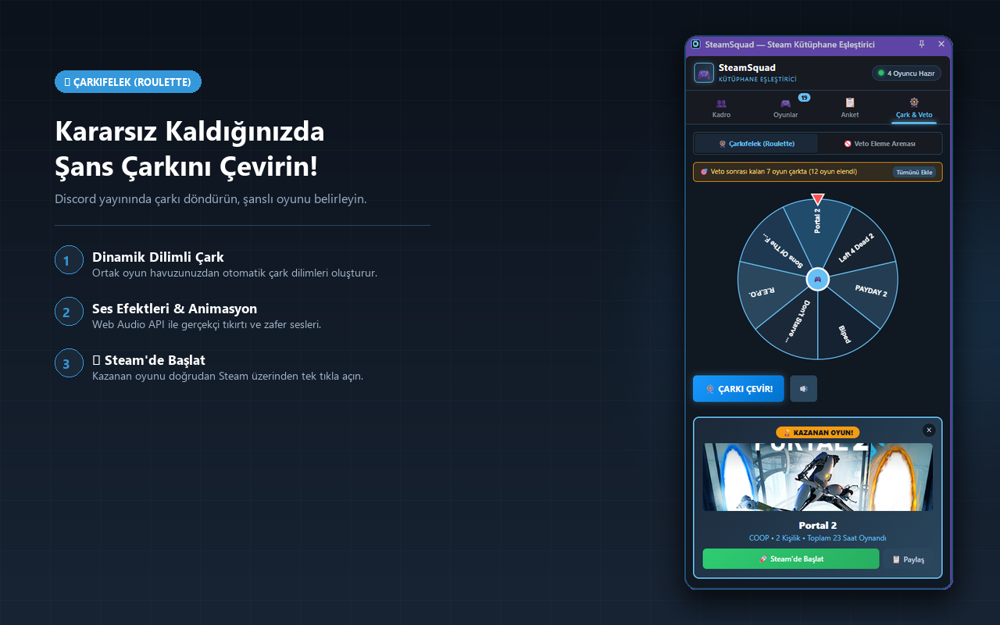
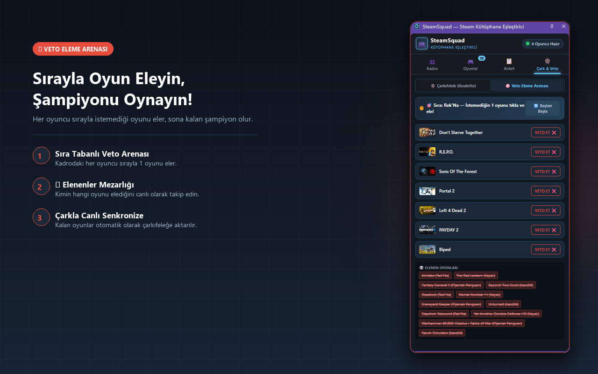
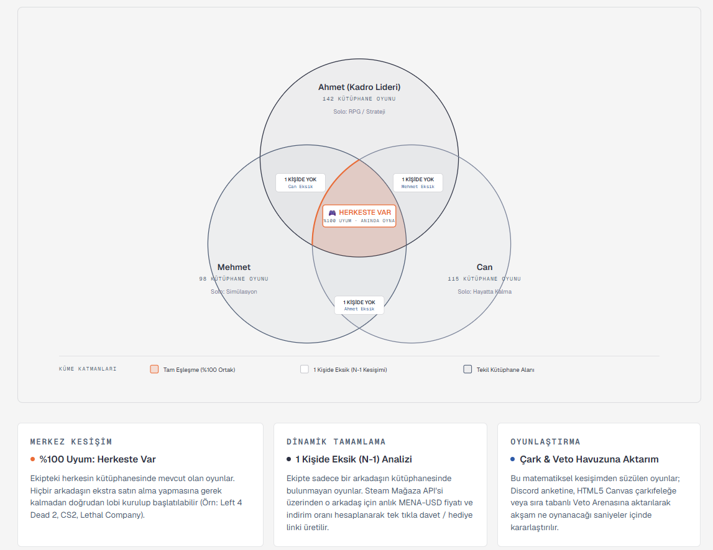

# 🎮 SteamSquad — Steam Library Matcher

<div align="center">

[](https://chromewebstore.google.com/detail/ipddbahofdhagjeheeolfloklgoeppeo?utm_source=item-share-cb)
[](manifest.json)
[](manifest.json)
[](src/sidepanel/sidepanel.html)
[](PRIVACY.md)
[](LICENSE)

**A smart Chrome Side Panel extension that instantly matches your gaming squad's Steam libraries, detects live store discounts, and settles game night indecision with interactive decision wheels, veto arenas, and instant Discord/WhatsApp group polls.**

[🚀 **Install from Chrome Web Store**](https://chromewebstore.google.com/detail/ipddbahofdhagjeheeolfloklgoeppeo?utm_source=item-share-cb)

<br>

[Screenshots](#-screenshots) • [The Problem & Motivation](#-the-problem--motivation) • [Key Features](#-key-features) • [Problems Solved](#-problems-solved) • [Real-World Use Cases](#-real-world-use-cases) • [Architecture & Tech Stack](#-architecture--tech-stack) • [Project Structure](#-project-structure) • [Installation Guide](#-installation-guide) • [Privacy & Security](#-privacy--security) • [License](#-license)

</div>

---

## 📸 Screenshots

<div align="center">
  
  <p><em>Zero-credential squad manager: add friends via public links and toggle custom sub-teams with one click.</em></p>
  
  <br>

  
  <p><em>Smart overlap engine: reveals 100% shared games, missing players, live Steam discounts, and 1-click invite copy.</em></p>

  <br>

  
  <p><em>Interactive 60 FPS HTML5 Canvas roulette wheel with Web Audio FX and direct Steam launch links.</em></p>

  <br>

  
  <p><em>Turn-based Veto Elimination Arena: each player eliminates unwanted games until one champion remains.</em></p>
</div>

---

## 🎯 The Problem & Motivation

Every weekend, gaming groups jump on Discord and spend **30 to 45 minutes** in endless debate before playing a single round:
- *"Do you have this game?"* — *"No, check my library."*
- *"Wait, his profile is private, who else has it?"*
- *"We have 5 players tonight, but this co-op game only supports 4!"*
- *"I'm missing this one, how much is it on Steam right now? Is it on sale?"*

**The Mission of SteamSquad:** Put an end to squad indecision in seconds. Without ever requiring Steam account logins or passwords, SteamSquad answers the three questions that matter most:
1. **"What multiplayer games can our entire squad play together right now?"**
2. **"If only 1 friend is missing a game, how much is it on sale, and can we nudge them to grab it?"**
3. **"When we can't agree, how can we fairly pick a winner in 30 seconds on Discord stream?"**

---

## 🚀 Key Features

### 1. 👥 Zero-Auth Squad & Sub-Teams Management
- **Zero Credentials Required:** Add friends in seconds using public Steam profile links (`steamcommunity.com/id/username`) or vanity URLs. No passwords, tokens, or Steam logins needed.
- **Dynamic Squad Presets:** Create custom sub-teams like *"Duo Team"*, *"Weekend 4"*, or *"5v5 CS Squad"*. Toggle specific players in and out of the active pool with single-click checkboxes.
- **Optional Web API Key Support:** Built-in drawer to optionally provide a free Steam Web API key to load massive 100+ game libraries seamlessly.

### 2. 🎯 Smart Library Overlap & Capacity Engine
- **100% Shared Games (All Own):** Instantly filters your game pool down to titles owned by every active player.
- **N-1 & N-2 Missing Player Detection:** Highlights games owned by almost everyone and isolates who needs it.
- **Player Capacity Awareness:** Filters games based on active squad size (e.g., automatically flags 4-player co-op limits when 5 friends are active).
- **Genre & Speed Filters:** Filter by Co-Op (PvE), PvP / Competitive, Party / Casual, Survival, or **"Quick Download (<5 GB)"** for spontaneous gaming sessions.

### 3. 🏷️ Live Steam Store Pricing & Discount Integration
- **Real-Time Discount Detection:** Queries official Steam Store endpoints to display live discount percentages and regional pricing (e.g., `-%66 $2.24 USD` or `Free`).
- **💬 1-Click Squad Invite (Nudge):** Generates a personalized, copyable invite message tailored for the missing friend, including current sale price and direct store links.

### 4. 🎡 Interactive Decision Wheel & Veto Arena
- **60 FPS HTML5 Canvas Roulette:** Automatically populates the spinning wheel with your filtered common games. Includes realistic pointer deceleration and Web Audio API synthesized clicking and fanfare sound effects.
- **Turn-Based Veto Elimination Arena:** Players take turns vetoing games they don't want to play. Eliminated titles are tracked in the *Graveyard*, and the survivor is crowned Champion.
- **Live Sync:** Games remaining after a veto session can be exported directly to the roulette wheel with one click.

### 5. 📋 1-Click Discord & WhatsApp Poll Exporter
- Formats top candidate games into emoji-numbered voting polls.
- Copies clean markdown ready to paste directly into Discord servers or WhatsApp group chats so friends without the extension can vote instantly.

### 6. ☑️ "Played" Game Tracking
- Click *"Played"* on any game card to track completed games.
- Played titles are automatically excluded from Polls, Roulette Wheels, and Veto Arenas to keep your recommendations fresh.

### 7. 🏪 In-Page Steam Store Badge (Content Script)
- **Automatic Store Detection:** While browsing any game on the official Steam Store (`store.steampowered.com/app/*`), a sleek, non-intrusive floating badge informs you if your squad owns the title.
- **Smart Ownership Highlights:** Displays full-squad matches (`🎉 All Own`), partial ownership (`👥 3/4 Own`), and isolates missing members with avatar tooltips.
- **1-Click Side Panel Trigger:** Clicking the badge immediately opens the Chrome Side Panel directly to your squad's active dashboard.

---

## 🧩 Problems Solved

| Traditional Game Night Setup | With SteamSquad |
| :--- | :--- |
| Asking everyone to read out their library list | Add profile links once; libraries are matched automatically in milliseconds. |
| Forgetting party limits (e.g., launching a 4-player game with 5 friends) | Smart metadata filters automatically verify player count compatibility. |
| Manually checking Steam store pages for sale prices | Live discount percentage and pricing are displayed directly on the game card. |
| Spending 30+ minutes arguing over what to play | Spin the sound-synthesized Roulette wheel or run a quick Veto elimination on Discord. |
| Typing manual poll options into Discord or WhatsApp | One-click button copies a pre-formatted emoji voting poll straight to your clipboard. |
| Popups closing every time you switch browser tabs | Built natively for the Chrome Side Panel API to stay open alongside Discord and Steam. |

---

## 🎮 Real-World Use Cases

### Scenario 1: The 4-Player Weekend Squad
Four friends jump on Discord on Saturday night. Activate the **"Weekend 4"** preset, select **"All Own"**, and filter by **"Co-Op / PvE"**. In 2 seconds, you have a curated list of games everyone already has installed and ready to play.

### Scenario 2: "Just 1 Person Missing" Sale Snatch
Select the **"1 Missing"** tier. SteamSquad reveals that 3 out of 4 players own *Don't Starve Together*, and it's currently on an 66% sale for $2.24. Click **"Share"** to copy a friendly invitation message and paste it to your friend in Discord.

### Scenario 3: Paralyzed by Choice on Discord Stream
Your squad owns 20+ common games and nobody can decide. Share your screen, head to **"Wheel & Veto"**, run a rapid Veto session to eliminate games people aren't in the mood for, and let the 60 FPS Roulette Wheel pick tonight's champion.

---

<a id="-architecture--tech-stack"></a>
## 🛠 Architecture & Tech Stack

<div align="center">
  
  <p><em>Multi-set intersection logic: computing exact N, N-1, and N-2 overlap sets across active players.</em></p>
</div>

<br>

- **Chrome Manifest V3:** Compliant with modern extension service workers, declarative configurations, and isolated contexts.
- **Chrome Side Panel API:** Persistent, side-by-side browser workflow that never dismisses on outside clicks.
- **Zero-Dependency Vanilla JavaScript (ES6+):** Pure modular JavaScript (`import`/`export`) with zero build bloat, delivering a featherlight bundle (<45 KB).
- **Public Steam XML & Community Endpoints:** Fetches avatar, username, and owned game lists directly via public endpoints without authentication.
- **Steam Store API & Queue Rate-Limiter:** Safely queries live store pricing with a 6-hour local cache and sequential request throttling to avoid 429 rate limits.
- **HTML5 Canvas & Web Audio API:** Standalone 60 FPS spinning wheel physics and programmatic synthesized sound effects with zero external audio assets.
- **Local Storage API (`chrome.storage.local`):** All squad configurations, custom teams, and played statuses remain 100% on your local machine.

---

## 📂 Project Structure

```text
steam-squad/
├── manifest.json              # Manifest V3 configuration (Side Panel, Storage, Steam permissions)
├── CHROMEWEBSTORE.md          # Chrome Web Store listing copy and permission justifications
├── README.md                  # Comprehensive project documentation
├── LICENSE                    # MIT License (Copyright 2026 Harun Uyguç)
├── PRIVACY.md                 # Formal privacy policy documentation
├── store-assets/              # High-resolution 1280x800 store & README screenshots
├── docs/                      # Technical documentation and architecture diagrams
├── icons/                     # 16x16, 48x48, 128x128 high-res PNG extension icons
└── src/
    ├── background/
    │   └── service-worker.js  # Side panel trigger and background extension service
    ├── content/
    │   ├── content.js         # In-page Steam store badge controller & SPA observer
    │   └── content.css        # Steam-themed floating badge glassmorphism styles
    ├── sidepanel/
    │   ├── sidepanel.html     # Main side panel layout and view containers
    │   ├── sidepanel.css      # Steam-themed dark UI styling and animations
    │   ├── sidepanel.js       # App controller, event orchestration, and view rendering
    │   ├── squad-manager.js   # Squad member management, custom teams, and storage persistence
    │   ├── overlap-engine.js  # Library overlap calculation, filter matrix, and sorting
    │   ├── poll-generator.js  # 1-click Discord and WhatsApp markdown poll generator
    │   └── roulette.js        # Canvas roulette wheel, audio synthesizer, and Veto arena
    └── services/
        ├── steam-service.js   # XML library parser, Store API client, and rate-limited queue
        └── game-metadata.js   # Curated multiplayer database (modes, capacities, size tiers)
```

---

## 📦 Installation Guide

### Option 1: Install from Chrome Web Store (Recommended)
Install SteamSquad with a single click from the official store:  
👉 [**SteamSquad on the Chrome Web Store**](https://chromewebstore.google.com/detail/ipddbahofdhagjeheeolfloklgoeppeo?utm_source=item-share-cb)

### Option 2: Manual Installation (Developer Mode)

1. Clone or download this repository to your computer:
   ```bash
   git clone https://github.com/HarunUYGUC/steam-squad.git
   ```
2. Open Google Chrome and navigate to `chrome://extensions/` in the address bar.
3. Enable **Developer mode** using the toggle switch in the top-right corner.
4. Click **Load unpacked** in the top-left corner.
5. Select the `steam-squad` directory.
6. The extension will install immediately! Click the SteamSquad icon in your extensions toolbar to open the Side Panel.

---

### Optional: Enabling Steam Web API Key (For Large Libraries)

1. If you or your friends own massive libraries (100+ games), obtain a free Steam Web API key from [steamcommunity.com/dev/apikey](https://steamcommunity.com/dev/apikey).
2. Open the SteamSquad Side Panel and click **"Unlock Full Library (Steam Web API)"** in the Squad tab.
3. Paste your API key and click **Save**.
4. SteamSquad will automatically fetch the complete game catalogs for all squad members. The key is stored strictly on your local device.

---

## 🔒 Privacy & Security

SteamSquad adheres strictly to a zero-login, privacy-first model:
- **Zero Passwords or Credentials:** SteamSquad never asks for your Steam account password or OAuth login.
- **100% Client-Side Storage:** All squad member names, avatars, custom teams, and settings are stored locally in your browser's private `chrome.storage.local`.
- **No Telemetry / No Tracking:** We do not operate remote tracking servers, collect personal data, or sell your information.
- **Direct Official Communication:** All network requests are made directly from your browser to official Valve endpoints (`steamcommunity.com` and `store.steampowered.com`).
- Read our full [Privacy Policy](PRIVACY.md) for complete details.

---

## 📄 License

This project is open-source and licensed under the [MIT License](LICENSE).

Steam and the Steam logo are registered trademarks of Valve Corporation. This project is not affiliated with Valve Corporation.
